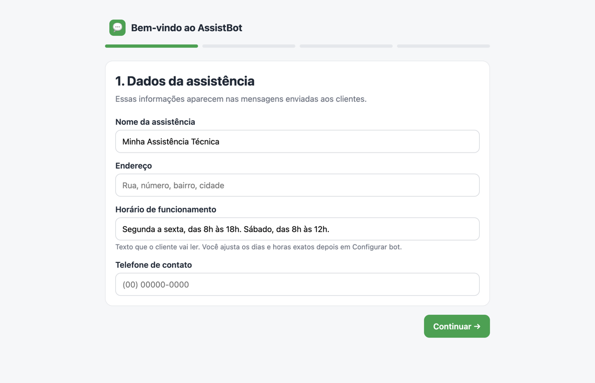
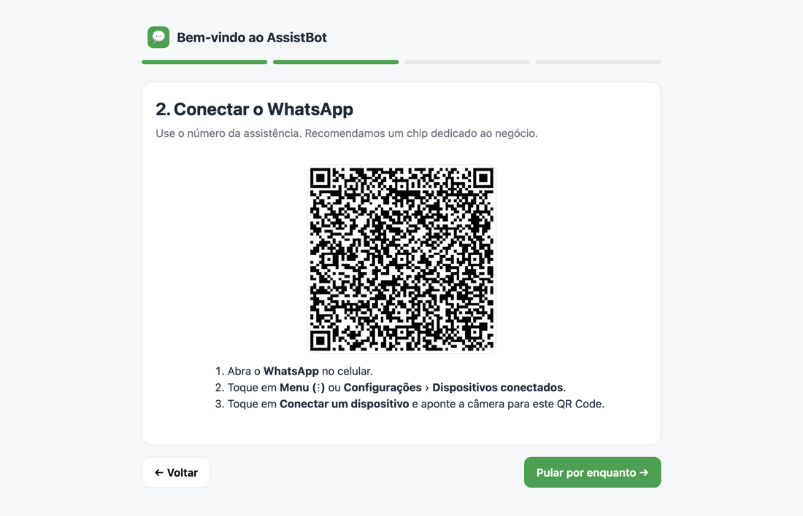
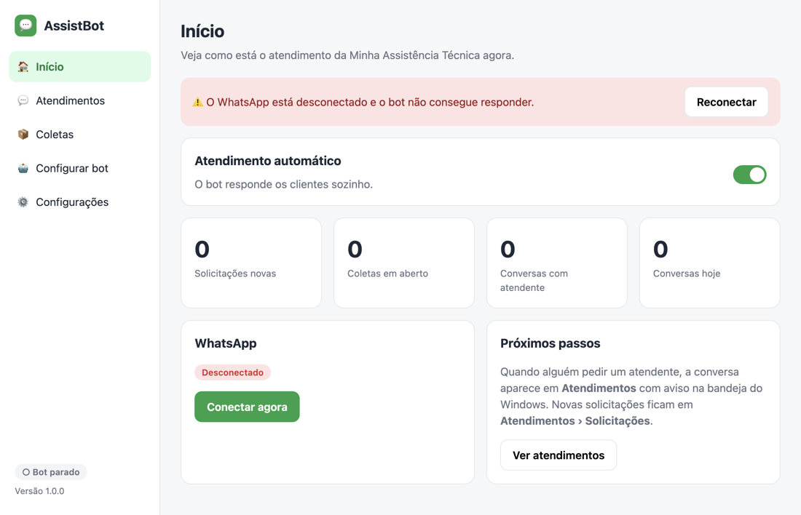
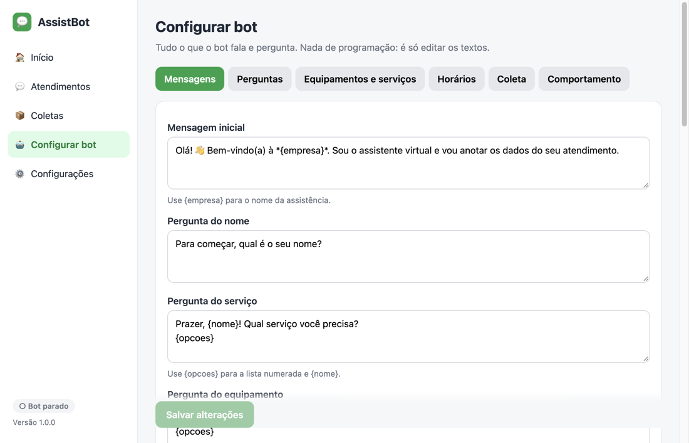
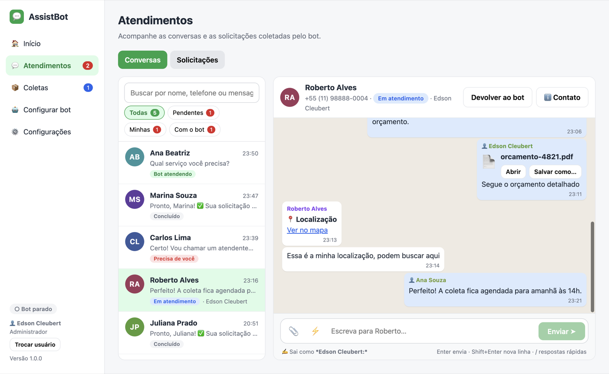
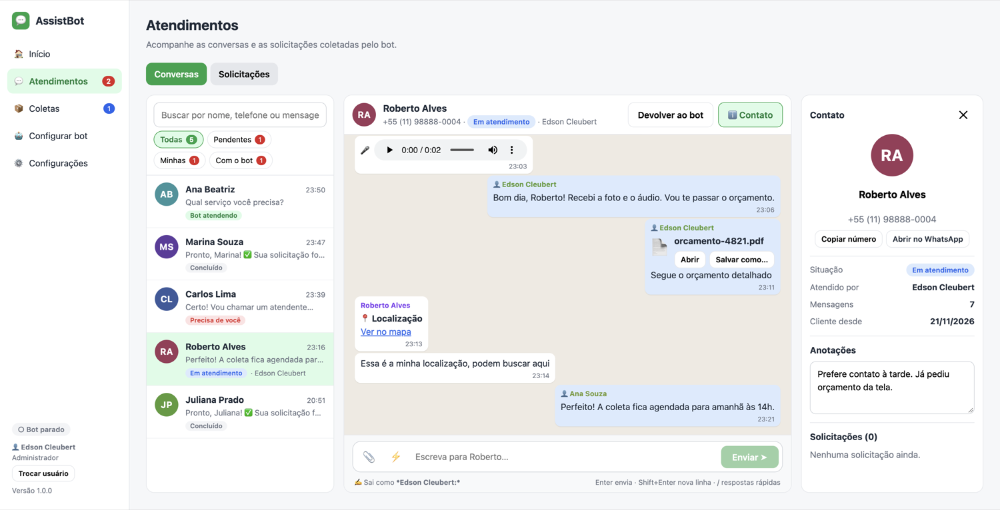
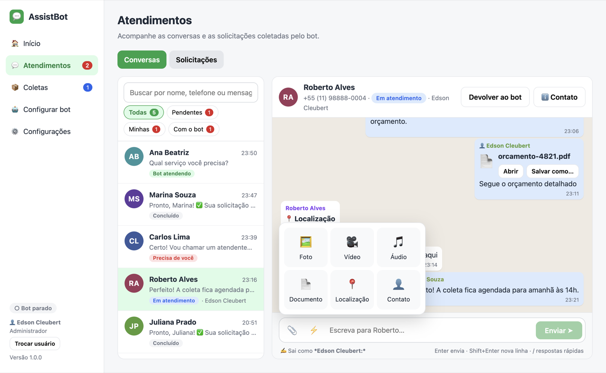
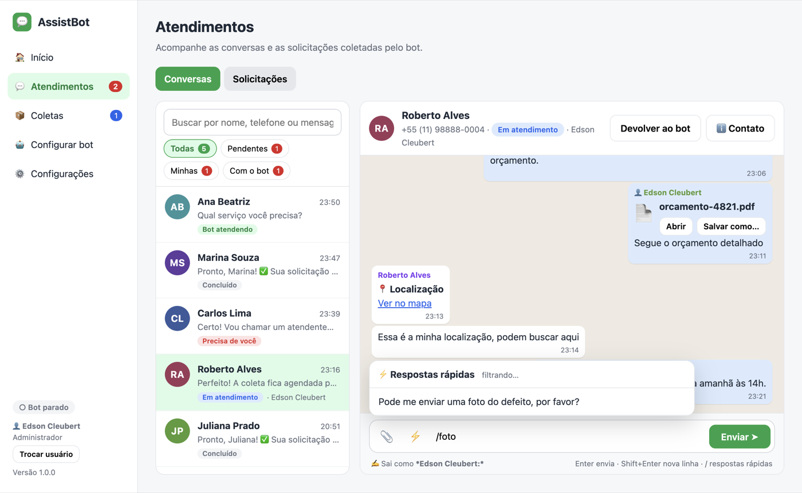
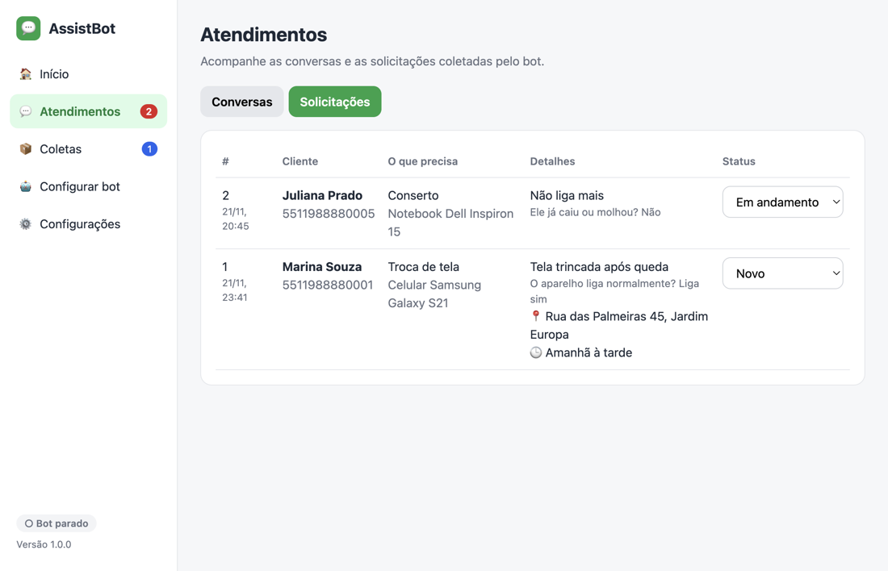

# AssistBot

Assistente de WhatsApp para assistência técnica (Electron + React + TypeScript + SQLite embutido `node:sqlite` + Baileys), com IA local opcional (llama.cpp + Bonsai 2 9B).

## Telas

| Assistente: dados da assistência | Assistente: conectar o WhatsApp |
|---|---|
|  |  |

| Início | Configurar bot |
|---|---|
|  |  |

### Atendimentos
Lista de conversas com busca e filtros (Todas, Pendentes, Minhas, Com o bot), avatar, hora, indicador de "sem resposta" e quem está atendendo; chat com separador de dia, mensagens agrupadas, foto/áudio/vídeo/documento/localização e botão "Ir para o fim"; painel de **contato** com nome editável, copiar número, abrir no WhatsApp, anotações, dados coletados pelo bot e histórico de solicitações. Imagens com dados fictícios.

| Conversas e chat | Painel de contato (janela larga) |
|---|---|
|  |  |

| Compose: anexos, localização e contato | Respostas rápidas (botão ⚡ ou digitando `/`) |
|---|---|
|  |  |

**Compose:** campo que cresce com o texto, Enter envia e Shift+Enter quebra a linha, rascunho guardado por conversa, anexos com pré-visualização antes de enviar (vários de uma vez, legenda no primeiro), **arrastar e soltar** arquivos, respostas rápidas editáveis (`{nome}` vira o primeiro nome do cliente), aviso claro quando o bot está conduzindo (ao enviar você assume) ou o WhatsApp está desconectado, e a assinatura que será usada.

| Solicitações |
|---|
|  |

## Comportamento no WhatsApp
Toda ação automática do bot (resposta, "digitando…") espera um **atraso aleatório de 2 a 5 segundos** (`src/main/whatsapp/jitter.ts`), para parecer natural e reduzir risco de bloqueio. Mensagens enviadas por uma pessoa pelo app saem imediatamente, sem atraso.

## Desenvolvimento
```bash
npm install
npm test          # motor de triagem
npm run dev       # abre o app
npm run dist      # gera release/AssistBot Setup x.y.z.exe (NSIS, sem admin)
```
No macOS arm64 o `makensis` embutido do electron-builder é x86; use `brew install makensis` e substitua `…/nsis-*/mac/makensis` por um script que chame `/opt/homebrew/bin/makensis`. Ou use o workflow `.github/workflows/build-windows.yml` (Windows real, com teste de instalação silenciosa).

## Atualizações
Publique `AssistBot Setup x.y.z.exe`, `.blockmap` e `latest.yml` em um endereço HTTPS e informe a URL em *Configurações › Atualizações › Avançado* (ou troque o `publish.url` em `package.json`). O `electron-updater` confere o SHA-512 de `latest.yml`. **Procedência:** assine o instalador com certificado de code signing (defina `CSC_LINK`/`CSC_KEY_PASSWORD`); sem ele o Windows SmartScreen avisa na instalação.

## IA local (opcional)
Em *Configurações › Inteligência artificial* o app detecta o hardware (RAM, núcleos, disco, placa de vídeo), escolhe sozinho a configuração do llama.cpp (CPU ou Vulkan, camadas na GPU, contexto, threads) e baixa motor + modelo com verificação SHA-256. O modelo é carregado sob demanda e descarregado quando ocioso.
- **Modelo:** Bonsai 2 9B **Q2_0 (2,5 GB) é o padrão**. Um Q4_0 foi gerado e medido (`docs/QUANTIZACAO.md`): 2× maior, ~40% mais lento e sem ganho de qualidade; o app já suporta o nível Q4_0, desativado até haver arquivo hospedado e ganho comprovado no Windows.
- Usos: entender respostas livres, responder perguntas sobre a loja (só com os dados cadastrados) e pré-preencher dados da primeira mensagem. Se a IA falhar ou demorar, o fluxo por regras segue normalmente.

## Arquitetura de IA
O motor (`src/main/bot/engine.ts`) é uma função pura `processMessage(sessão, texto, contexto)`; a IA entra por `AiProvider` (`src/main/ai/provider.ts`) como complemento, sem substituir as regras. O motor (`src/main/bot/engine.ts`) é uma função pura `processMessage(sessão, texto, contexto)`; um provedor de IA pode ser plugado como fallback para respostas não reconhecidas, sem mudar o restante.

## Checklist de teste em Windows limpo (manual)
1. Instalar o .exe (sem pedir administrador); atalhos criados. 2. Assistente: 4 passos, ler o QR. 3. Mandar mensagem de outro número e completar o fluxo; conferir Solicitação/Coleta. 4. Responder pelo celular: o bot silencia. 5. Fechar a janela: ícone na bandeja, bot continua. 6. Reiniciar o Windows: abre sozinho minimizado e reconecta. 7. Desligar o Wi‑Fi: aviso de sem internet; religar: reconecta. 8. Instalar versão nova por cima: dados preservados. 9. Desinstalar.
